## 👋 Hi, I'm Aditya

I work at the intersection of **machine learning, quantitative finance, and product building** — focused on creating adaptive, data-driven investment systems.

---

## 🧠 What I'm Working On

| | |
|---|---|
| 📊 | AI-powered **risk profiling systems** |
| 📈 | **Portfolio optimization** — MPT, Black-Litterman, AI allocation |
| 🤖 | **Reinforcement learning for trading** |
| 🧩 | Building **Dhanvira** — AI portfolio intelligence platform |

---

## 📄 Research & Publications

**🧾 AI-Driven Financial Advisory Systems**

* Risk profiling using behavioral & financial data
* Portfolio optimization (MPT, Black-Litterman)
* Reinforcement learning for dynamic asset allocation
* Backtesting on historical market data
* Focus on robustness, interpretability & real-world applicability

📌 *IEEE conference submission in progress*

---

## 💼 Experience Highlights

* Built AI-driven fintech solutions improving engagement by 20%+
* Developed intelligent chatbot systems for financial advisory
* Worked with **National Informatics Centre (Govt. of India)** on digital platform strategy
* Market research & business strategy at **Admitad India**

---

## ⚙️ Tech Stack

| Category | Technologies |
|---|---|
| **Languages** | Python, JavaScript, SQL, C |
| **ML / AI** | PyTorch, Scikit-learn, Pandas, NumPy |
| **Finance** | Quant models, Portfolio Optimization, Financial Modeling, Algorithmic Trading |
| **Web** | Vue.js, Node.js, NestJS |
| **Database** | MongoDB |

---

## 📊 GitHub Activity

---

## 🎯 Current Focus

* Scaling **AI in finance**
* Real-world deployment of **quant models**
* Bridging **research → product → startup**

---

## ⚡ Philosophy

> Build systems, not projects.
> Think in models, not features.
> Optimize for learning speed over comfort.

---

## 🌐 Connect With Me

⭐️ If you're working in AI, finance, or building something ambitious — let's connect.

